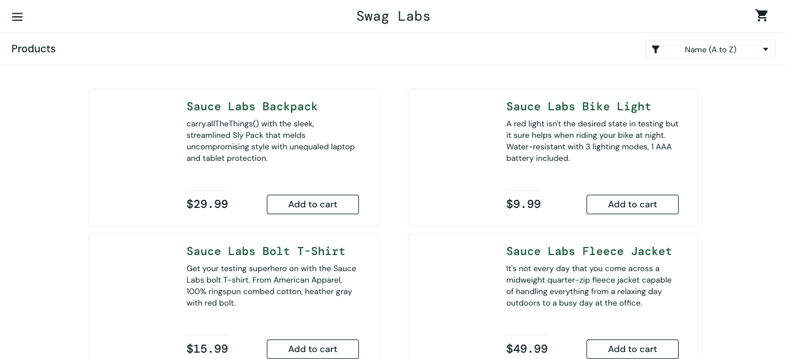
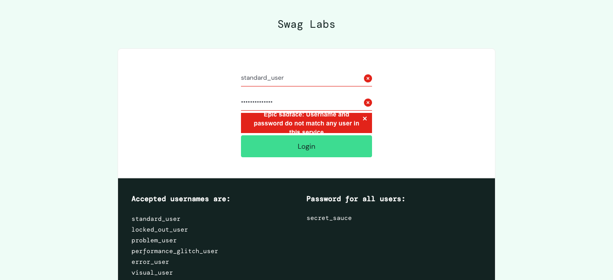
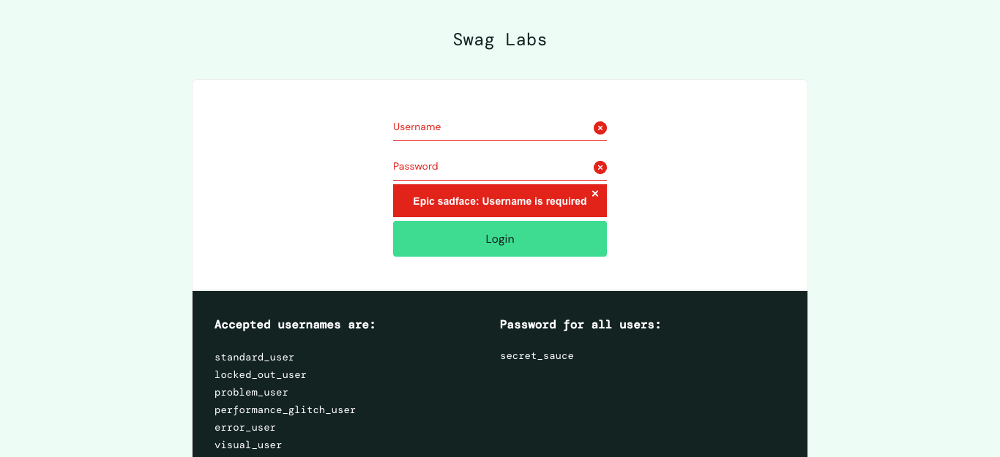
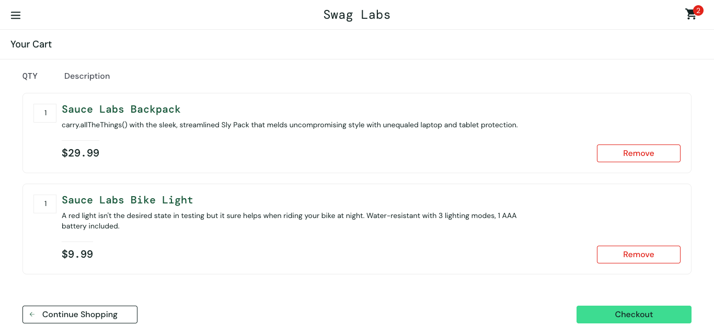
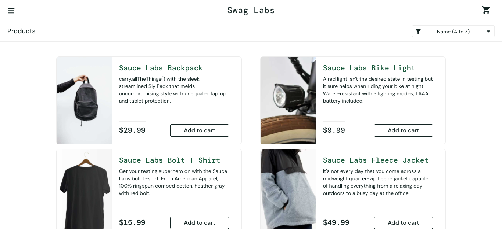
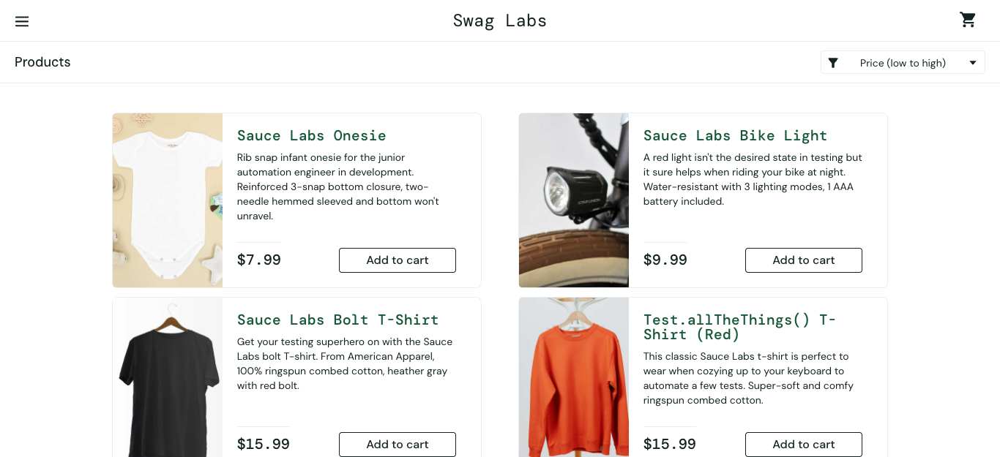
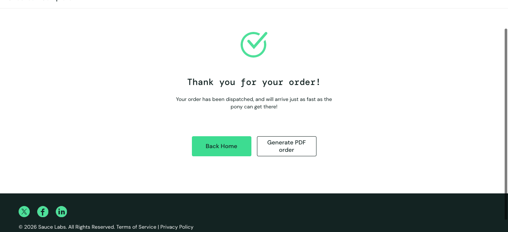
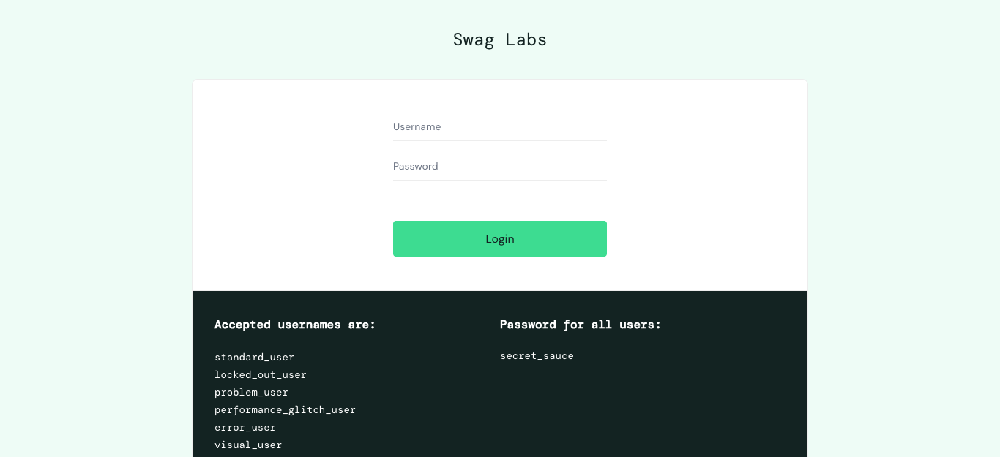
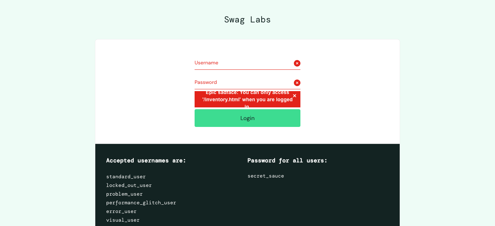

# Lab 9 – Kiểm thử tự động với Selenium WebDriver

| | |
|---|---|
| **Sinh viên** | Trần Đình Danh |
| **Mã sinh viên** | 23010211 |
| **Môn học** | Đánh giá và kiểm định chất lượng phần mềm |
| **Giảng viên hướng dẫn** | TS. Trịnh Thanh Bình |
| **Bài tập** | Lab 9: Công cụ kiểm thử Selenium |

## 1. Giới thiệu

**Selenium** là bộ công cụ mã nguồn mở dùng để tự động hóa trình duyệt web. Thành phần chính được dùng trong bài lab là **Selenium WebDriver**: thư viện cho phép điều khiển trình duyệt thật (Chrome, Firefox, Edge, …) thông qua code (Python, Java, C#, JS…) để mô phỏng thao tác người dùng như mở trang, nhập liệu, click, đọc nội dung và kiểm tra kết quả.

Các thành phần của bộ Selenium:

| Thành phần | Vai trò |
|---|---|
| Selenium WebDriver | API điều khiển trình duyệt bằng code – dùng trong bài này |
| Selenium IDE | Extension trình duyệt cho phép ghi/phát lại thao tác (record & playback) |
| Selenium Grid | Chạy test song song trên nhiều máy / nhiều trình duyệt |

### Kiến thức Selenium đã tìm hiểu

- **Khởi tạo driver**: `webdriver.Chrome(options=...)` – từ Selenium 4.6, *Selenium Manager* tự tải ChromeDriver phù hợp, không cần cài driver thủ công.
- **Định vị phần tử (Locator)**: `By.ID`, `By.CLASS_NAME`, `By.CSS_SELECTOR`, `By.XPATH`, `By.NAME`, …
- **Thao tác**: `click()`, `send_keys()`, `clear()`, `Select(...).select_by_value()` cho dropdown.
- **Chờ (Wait)**:
  - *Implicit wait* – `driver.implicitly_wait(5)`: chờ tối đa N giây khi tìm phần tử.
  - *Explicit wait* – `WebDriverWait(driver, 10).until(EC....)`: chờ đến khi thỏa điều kiện cụ thể (phần tử click được, URL chứa chuỗi…).
- **Assertion**: kết hợp với `pytest` để so sánh kết quả thực tế với kết quả mong đợi.
- **Headless mode**: chạy Chrome không hiển thị giao diện (`--headless=new`), phù hợp chạy CI.
- **Screenshot**: `driver.save_screenshot()` để lưu minh chứng.

Tài liệu tham khảo:
- Tài liệu chính thức: https://www.selenium.dev/documentation/
- Selenium with Python: https://selenium-python.readthedocs.io/
- Video: *Selenium Python Tutorial* – các playlist hướng dẫn Selenium + Python + Pytest trên YouTube.

## 2. Website được kiểm thử

**Swag Labs – https://www.saucedemo.com/** : website bán hàng demo do Sauce Labs cung cấp, được xây dựng riêng cho việc luyện tập kiểm thử tự động. Website có đủ các chức năng: đăng nhập, danh sách sản phẩm, sắp xếp, giỏ hàng, thanh toán, đăng xuất.

Tài khoản thử nghiệm (công khai trên trang):

| Username | Password | Ghi chú |
|---|---|---|
| `standard_user` | `secret_sauce` | Tài khoản bình thường |
| `locked_out_user` | `secret_sauce` | Tài khoản bị khóa |

## 3. Công cụ & môi trường

| Công cụ | Phiên bản |
|---|---|
| Python | 3.14 |
| Selenium | 4.x |
| Pytest | 8.x |
| pytest-html | 4.x (xuất báo cáo HTML) |
| Trình duyệt | Google Chrome (ChromeDriver tự quản lý bởi Selenium Manager) |
| Hệ điều hành | macOS |

## 4. Cấu trúc thư mục

```
Lab9_Selenium/
├── tests/
│   ├── conftest.py          # Fixture khởi tạo/đóng Chrome, hàm login dùng chung, chụp màn hình
│   └── test_saucedemo.py    # 10 test case
├── screenshots/             # Ảnh chụp màn hình cuối mỗi test case
├── report.html              # Báo cáo kết quả do pytest-html sinh ra
├── requirements.txt
├── pytest.ini
└── README.md
```

## 5. Danh sách test case

| ID | Chức năng | Mô tả / Các bước | Dữ liệu | Kết quả mong đợi |
|---|---|---|---|---|
| TC01 | Đăng nhập | Nhập username, password hợp lệ → bấm Login | standard_user / secret_sauce | Chuyển đến `inventory.html`, tiêu đề "Products" |
| TC02 | Đăng nhập | Nhập đúng username, sai password → Login | standard_user / wrong_password | Hiện lỗi "Username and password do not match…" |
| TC03 | Đăng nhập | Đăng nhập bằng tài khoản bị khóa | locked_out_user / secret_sauce | Hiện lỗi "Sorry, this user has been locked out." |
| TC04 | Đăng nhập | Bỏ trống cả 2 ô → Login | (trống) | Hiện lỗi "Username is required" |
| TC05 | Giỏ hàng | Đăng nhập → thêm Backpack và Bike Light → mở giỏ hàng | – | Badge giỏ hàng = 2, giỏ chứa đúng 2 sản phẩm |
| TC06 | Giỏ hàng | Thêm Backpack → bấm Remove | – | Badge giỏ hàng biến mất |
| TC07 | Tìm kiếm / Sắp xếp | Chọn sắp xếp "Price (low to high)" | – | Danh sách giá được sắp xếp tăng dần |
| TC08 | Thanh toán | Thêm Onesie → Checkout → nhập thông tin → Continue → Finish | Danh / Tran / 100000 | Hiện "Thank you for your order!" |
| TC09 | Đăng xuất | Mở menu ☰ → Logout | – | Quay về trang đăng nhập |
| TC10 | Bảo mật | Truy cập thẳng `/inventory.html` khi chưa đăng nhập | – | Bị chặn, hiện lỗi yêu cầu đăng nhập |

## 6. Hướng dẫn chạy

```bash
# 1. Tạo môi trường ảo và cài thư viện
python3 -m venv .venv
source .venv/bin/activate        # Windows: .venv\Scripts\activate
pip install -r requirements.txt

# 2. Chạy toàn bộ test (headless) và xuất báo cáo HTML
pytest --html=report.html --self-contained-html

# 3. Chạy có hiện cửa sổ Chrome để quan sát
HEADLESS=0 pytest
```

## 7. Kết quả kiểm thử

Chạy lệnh `pytest --html=report.html --self-contained-html` ngày 21/10/2026, trên Chrome 155 chế độ headless:

```
collected 10 items

tests/test_saucedemo.py::test_tc01_login_success PASSED                  [ 10%]
tests/test_saucedemo.py::test_tc02_login_wrong_password PASSED           [ 20%]
tests/test_saucedemo.py::test_tc03_login_locked_user PASSED              [ 30%]
tests/test_saucedemo.py::test_tc04_login_empty_fields PASSED             [ 40%]
tests/test_saucedemo.py::test_tc05_add_product_to_cart PASSED            [ 50%]
tests/test_saucedemo.py::test_tc06_remove_product_from_cart PASSED       [ 60%]
tests/test_saucedemo.py::test_tc07_sort_price_low_to_high PASSED         [ 70%]
tests/test_saucedemo.py::test_tc08_checkout_complete PASSED              [ 80%]
tests/test_saucedemo.py::test_tc09_logout PASSED                         [ 90%]
tests/test_saucedemo.py::test_tc10_access_inventory_without_login PASSED [100%]

============================= 10 passed in 20.06s ==============================
```

| ID | Chức năng | Kết quả |
|---|---|---|
| TC01 | Đăng nhập thành công | ✅ Pass |
| TC02 | Đăng nhập sai mật khẩu | ✅ Pass |
| TC03 | Đăng nhập tài khoản bị khóa | ✅ Pass |
| TC04 | Đăng nhập bỏ trống thông tin | ✅ Pass |
| TC05 | Thêm sản phẩm vào giỏ hàng | ✅ Pass |
| TC06 | Xóa sản phẩm khỏi giỏ hàng | ✅ Pass |
| TC07 | Sắp xếp giá tăng dần | ✅ Pass |
| TC08 | Thanh toán đơn hàng | ✅ Pass |
| TC09 | Đăng xuất | ✅ Pass |
| TC10 | Truy cập khi chưa đăng nhập | ✅ Pass |

**Tổng: 10/10 test case PASS (100%).** Báo cáo chi tiết: [report.html](report.html) (tải về rồi mở bằng trình duyệt).

> Ghi chú khi thực hành: ở lần chạy đầu TC05 bị lỗi `StaleElementReferenceException` vì script đọc danh sách sản phẩm khi trang giỏ hàng chưa render xong. Đã sửa bằng cách thêm **Explicit Wait** (`EC.url_contains("cart.html")` và `EC.presence_of_all_elements_located`) trước khi đọc dữ liệu.

### Ảnh minh chứng

| TC01 – Đăng nhập thành công | TC02 – Sai mật khẩu |
|---|---|
|  |  |
| **TC03 – Tài khoản bị khóa** | **TC04 – Bỏ trống thông tin** |
|  |  |
| **TC05 – Thêm vào giỏ hàng** | **TC06 – Xóa khỏi giỏ hàng** |
|  |  |
| **TC07 – Sắp xếp giá tăng dần** | **TC08 – Thanh toán thành công** |
|  |  |
| **TC09 – Đăng xuất** | **TC10 – Chặn truy cập khi chưa đăng nhập** |
|  |  |

## 8. Một số đoạn code tiêu biểu

**Fixture khởi tạo trình duyệt (conftest.py)**

```python
@pytest.fixture
def driver(request):
    options = Options()
    options.add_argument("--headless=new")
    drv = webdriver.Chrome(options=options)
    drv.implicitly_wait(5)
    drv.get(BASE_URL)
    yield drv
    drv.save_screenshot(f"screenshots/{request.node.name}.png")
    drv.quit()
```

**Test đăng xuất dùng Explicit Wait (do menu có hiệu ứng trượt)**

```python
def test_tc09_logout(driver):
    login(driver)
    driver.find_element(By.ID, "react-burger-menu-btn").click()
    WebDriverWait(driver, 10).until(
        EC.element_to_be_clickable((By.ID, "logout_sidebar_link"))).click()
    WebDriverWait(driver, 10).until(EC.visibility_of_element_located((By.ID, "login-button")))
    assert driver.current_url.rstrip("/") == "https://www.saucedemo.com"
```

## 9. Kết luận

- Đã tìm hiểu Selenium WebDriver và áp dụng cùng Pytest để xây dựng **10 test case tự động** cho website Swag Labs, bao phủ các chức năng: đăng nhập (hợp lệ / sai mật khẩu / tài khoản khóa / bỏ trống), giỏ hàng (thêm / xóa), sắp xếp sản phẩm, thanh toán, đăng xuất và kiểm tra truy cập trái phép.
- Kiểm thử tự động giúp chạy lại nhanh, nhất quán, dễ tích hợp CI; tuy nhiên cần chú ý dùng **Explicit Wait** cho các phần tử có hiệu ứng/tải chậm để tránh test chập chờn (flaky), và nên tách locator/hàm dùng chung (như `login()`) để dễ bảo trì.
